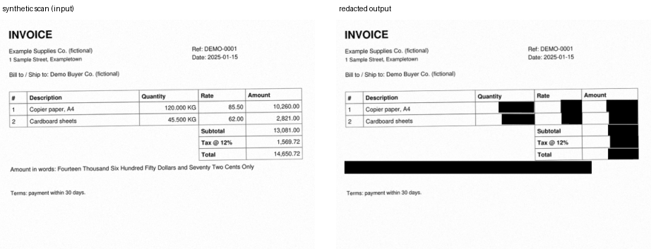

# bill-redaction-tool

**Offline invoice redaction that finds the money by its arithmetic.** Give it
a PDF bundle (an invoice, a delivery note, a packing list, scanned or
born-digital) and it blacks out the line amounts, totals, taxes, unit rates,
quantities and the "amount in words". You don't need a template for each
vendor's layout. It reads the page with OCR (or the PDF text layer) and
redacts the numbers that **add up to other numbers** on the page, plus the
numbers that are an **amount divided by a quantity**.



<sub>All documents in this repo are synthetic: a fictional seller, buyer and
items rendered by `examples/make_synthetic.py`.</sub>

## Why

Commercial paperwork often has to be shared with people who need the
*document* but must not see the *prices*: transporters, warehouses, auditors,
data-labelling vendors, or an ML training set. The usual document redaction
tools either:

- need a template per layout (fine for one form, hopeless across hundreds of
  vendors that each format their own invoice), or
- run named-entity / PII redaction, which knows what a phone number looks like
  but not which `1,569.72` is a tax amount and which is a reference number.

This tool uses a property that every bill shares, whatever its layout: **the
sensitive numbers are tied together by arithmetic.**

- **Layout-free.** There are no coordinates, field labels or vendor rules.
  The same config works on any layout that prints its sums.
- **Offline.** Everything runs locally on CPU: PyMuPDF for PDFs, and the
  public PP-OCR models through ONNX Runtime for scans. Nothing is sent to an
  OCR or LLM service.
- **Fail-closed.** If the expected documents aren't found, or no arithmetic
  relation shows up on one of them, no output is written for that file.
- **Unrecoverable output.** Redacted pages are re-rendered as images, so the
  covered values are gone from the file and there's no text layer underneath
  them. Document metadata is cleared.

## How it works

```
 PDF / image ──► text boxes ──► classify pages ──► quantities ──► amounts ──► relations ──► paint ──► PDF
               (text layer      (keywords per      (number +      (all other    (subset sums,
                or ONNX OCR)     document kind)     unit, 3 dp)    numbers)      amount/qty = rate)
```

1. **Text boxes.** Born-digital PDFs use their own text layer, one box per
   line. Scanned pages go through PP-OCRv5: DB text detection, then a page
   orientation pick (0/90/180/270, with an angle classifier and recognition
   confidence), a small-angle deskew per crop, and CTC recognition.
2. **Page classification** (optional). Each configured document kind has
   keywords. A page goes to the kind whose keywords occur most often, and the
   first page of each kind is used. Numbers from all these pages are pooled, so
   a total on the delivery note can explain line amounts on the invoice.
3. **Quantities.** A number followed by a unit (`120.000 KG`), a number with a
   unit in the next box on the same line, or a number with a quantity-like
   number of decimals (3 by default) counts as a quantity.
4. **Amounts.** Every other number on the document pages is a candidate.
   Small integers (≤ 5 by default), date parts, codes like `X-7`, IDs glued to
   letters and percentages are skipped.
5. **Relations.**
   - *Subset sums:* any 2 to 6 candidates whose sum equals another candidate
     (±1.00) are redacted, together with that total. This catches line items
     and subtotal, subtotal and tax and total, and so on. The search stops
     early on pages with very many numbers (see `combination_budget`).
   - *Rates:* for each redacted amount and each quantity, `amount / quantity`
     is computed. A candidate within 1 % of it is a unit rate.
   - Quantities themselves, and any box matching an *amount in words* pattern
     (`... Dollars ... Only`), are redacted.
6. **Paint and write.** Each matching box is filled with a solid colour. The
   redacted pages replace the originals in the output PDF, and other pages are
   copied as they are.

Run `bill-redact plan file.pdf` to see the plan (pages, quantities, values
and box texts) before you write anything.

## Quick start

```bash
git clone <this repo> && cd bill-redaction-tool
python -m venv .venv && . .venv/bin/activate      # Windows: .venv\Scripts\activate
pip install -e ".[ocr,dev]"                        # or: pip install -r requirements.txt

# synthetic demo bundle: a born-digital and a "scanned" version
python examples/make_synthetic.py

# born-digital PDFs need no models
bill-redact redact examples/data/synthetic_bundle.pdf -c examples/config.yaml -o examples/output

# scanned PDFs / images: download the public PP-OCR ONNX models once (~22 MB)
bill-redact fetch-models --dir models
bill-redact redact examples/data -c examples/config.yaml --models-dir models -o examples/output
```

Each output gets a `.json` report next to it with the document pages and the
number of boxes per page. It leaves out the redacted values, so the report
doesn't leak them. The exit code is 0 when every file was redacted and 1 when
any file was skipped.

Other commands:

```bash
bill-redact plan  bundle.pdf -c my.yaml    # dry run, prints values and box texts
bill-redact ocr   scan.pdf                 # text boxes as JSON (debug OCR)
bill-redact config > my.yaml               # every option with its default
bill-redact fetch-models --variant server  # larger, more accurate models (~170 MB)
```

From Python:

```python
from bill_redact import load_config, process_file
from bill_redact.ocr.onnx_ocr import OnnxOcr

cfg = load_config("my.yaml")
res = process_file("bundle.pdf", "out/bundle.pdf", cfg, ocr=OnnxOcr("models"))
print(res.ok, res.plan.summary())
```

`plan_redaction(pages, cfg)` works on any list of `TextBox(text, quad)`, so you
can plug in a different OCR engine (Tesseract, a cloud OCR, your own).

## Configuration

Everything that depends on your documents lives in a YAML file. See
[`examples/config.yaml`](examples/config.yaml), or print the defaults with
`bill-redact config`.

```yaml
documents:                 # optional; omit to pool all pages
  - name: invoice
    keywords: ["invoice"]
  - name: delivery_note
    keywords: ["delivery note"]
skip_pages: [0]            # e.g. a cover sheet that should never be classified
redact_all_pages: false    # also paint matching values on non-document pages

quantity:
  units: [KG, KGS, T, TONNES, PCS]
  decimal_places_with_unit: [0, 1, 2, 3]
  decimal_places_without_unit: [3]   # [] if your amounts also use 3 decimals
  grouped_integer_scale: null        # e.g. 1000 to read "12,500 KG" as 12.5 (tonnes)
  redact: true

amounts:
  ignore_integers_up_to: 5
  relative_tolerance: 0.01   # rate matching
  sum_tolerance: 1.0         # subset sums (absolute)
  max_terms: 6
  combination_budget: 2000000

amount_in_words_patterns:    # Python regexes, case-insensitive
  - '\b(rupees?|inr|dollars?|usd|euros?|eur)\b.*\bonly\b'
extra_patterns: []           # always redact boxes matching these regexes
fill: [0, 0, 0]              # RGB; [255, 255, 255] for white-out
pad: 2
fail_closed: true
```

**Tips**

- Start with `bill-redact plan` on a few real files and tune `units`,
  `decimal_places_without_unit` and the document keywords until the plan
  matches what you'd redact by hand.
- If your bundles have a fixed first page (a cover or transmittal sheet),
  put it in `skip_pages` so it can't be picked as a
  document. With `quantity_pages: all` (the default), its quantities are
  still used.
- Use `extra_patterns` for things arithmetic can't find, such as bank account
  numbers or a "Rate:" column on one-line bills.

## Project layout

```
src/bill_redact/
  analysis.py     number parsing, page classification, quantities, subset sums, rates, plan
  config.py       RedactConfig dataclasses and YAML loading
  pages.py        PDF/image loading (text layer or raster), painting, raster PDF output
  pipeline.py     process_file(): load -> text boxes -> plan -> paint -> write + report
  models.py       download + checksum the public PP-OCR ONNX models
  cli.py          `bill-redact` command
  ocr/
    onnx_ocr.py       PP-OCR detection + orientation + recognition with ONNX Runtime
    db_postprocess.py DB box extraction (adapted from PaddleOCR, Apache-2.0)
examples/         make_synthetic.py (fictional bundle + scan simulator), config.yaml
tests/            pytest: parsing, relations, classification, fail-closed, PDF output, CLI, OCR
```

Run the tests with `pytest`. The OCR end-to-end test runs once
`models/det.onnx` exists, or when `BILL_REDACT_MODELS` points at a model
folder.

## Limitations

- **No arithmetic, no redaction.** A one-line bill that prints only a total,
  or a page with prices but no totals, has no relations to find. The file is
  skipped (fail-closed), or you can add `extra_patterns`.
- **Coincidences over-redact.** On a page with many numbers, some unrelated
  values will happen to add up. That costs readability, not privacy.
- **OCR errors under-redact.** If OCR misreads `1,569.72` as `1,560.72`, that
  value may not match its relation and stays visible. Review the output for
  important batches, and use the server models for poor scans.
- **Box granularity.** A whole OCR or text line is painted, so a line that
  mixes a label and a value loses both.
- **Subset search is bounded.** With many candidates, the larger subset sizes
  are skipped (a warning is logged). Very long tables may need a larger
  `combination_budget` or `max_terms`.
- **Not a general PII redactor.** Names, addresses, tax IDs and signatures
  aren't touched unless you add `extra_patterns`. Pair it with a PII/NER tool
  if you need that too.

## Credits

Built by Ansh Singh ([@ansh200516](https://github.com/ansh200516)), Reyansh
([@Reyansh04](https://github.com/Reyansh04)) and Anmol Goel
([@goelanmol124](https://github.com/goelanmol124)).

OCR uses the PP-OCRv5 models from [PaddleOCR](https://github.com/PaddlePaddle/PaddleOCR)
in the ONNX exports published by [RapidOCR](https://github.com/RapidAI/RapidOCR).
The models are downloaded on demand and aren't part of this repository.
